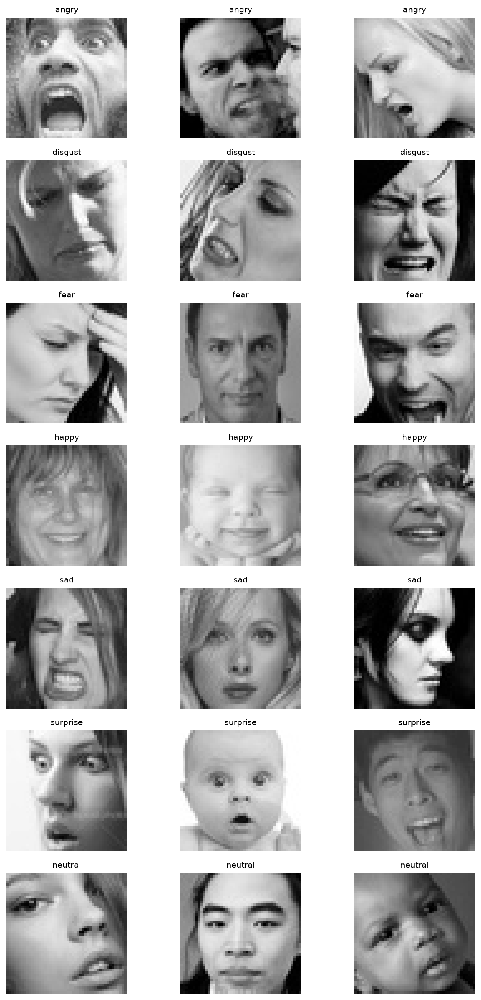
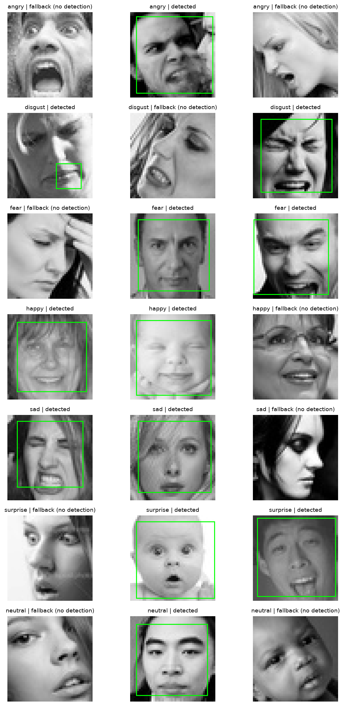
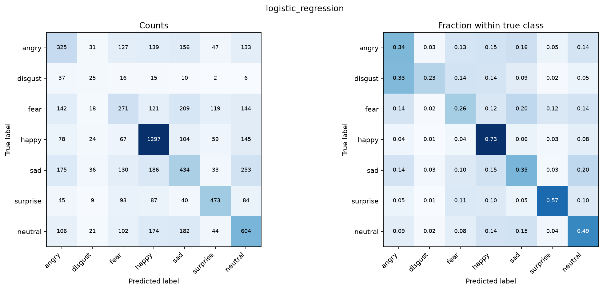
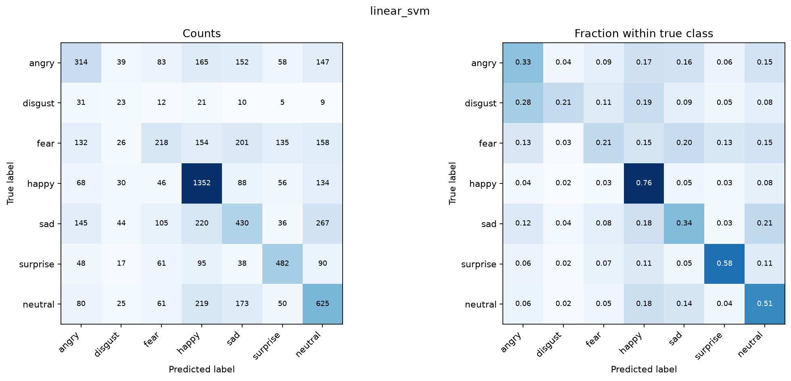
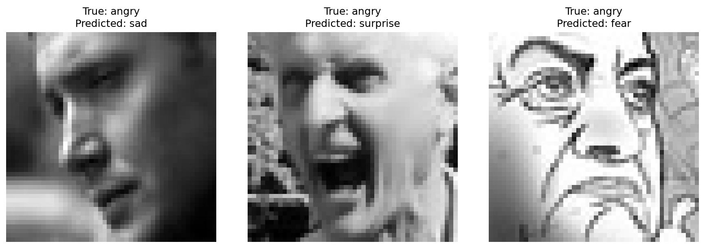
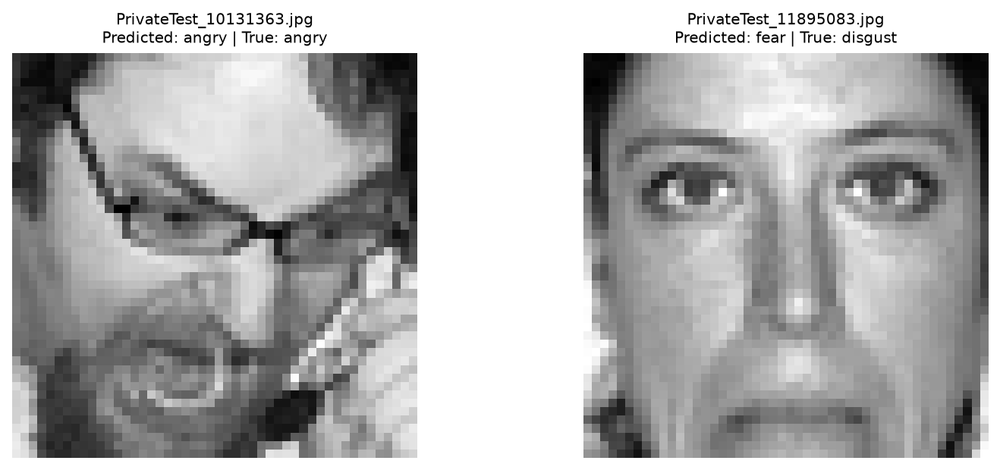

# Week 7 Facial Emotion Recognition Laboratory Report

Name: [Enter your name]
Course and section: [Enter your course and section]
Date: [Enter submission date]
Team members and actual roles: [Enter the work completed by each member]

## Objective

This laboratory developed and evaluated a seven-class facial expression classifier using FER2013. The implementation followed Track B: a pretrained CNN extracted image features, and two classical machine-learning models classified the resulting feature vectors. The workflow covered dataset verification, face detection, preprocessing, feature extraction, model training, evaluation, and prediction on held-out images. The output labels represent facial-expression categories in the dataset; they do not establish a person's internal emotional state.

## Dataset and train-test verification

The dataset was obtained from the public FER2013 folder-format release at https://www.kaggle.com/datasets/msambare/fer2013. The downloaded archive contained 35,887 images: 28,709 in the training folders and 7,178 in the test folders. All images were readable and had the required 48×48 dimensions. The seven classes were angry, disgust, fear, happy, sad, surprise, and neutral.

The original folder split was preserved, with documented exclusions from training. Exact decoded-pixel hashing identified 531 groups shared across train and test, and 57 groups with conflicting labels somewhere in the dataset. The training exclusions consisted of 703 images matching test images, 73 images assigned to conflicting training-label groups after overlap exclusions, and 1,021 additional repeated training copies. These mutually exclusive reasons account for 1,797 exclusions, leaving 26,912 training images. The original files were not deleted or relabeled.

The complete 7,178-image test set was retained. Its filenames include 3,589 PublicTest and 3,589 PrivateTest entries, so these results should not be presented as original PrivateTest-only benchmark results. Test labels were not used for classifier fitting or model selection. Test image hashes were used only to identify exact overlap with training.


| Expression | Original training | Retained training | Test |
| --- | --- | --- | --- |
| angry | 3995 | 3776 | 958 |
| disgust | 436 | 350 | 111 |
| fear | 4097 | 3797 | 1024 |
| happy | 7215 | 7030 | 1774 |
| sad | 4830 | 4677 | 1247 |
| surprise | 3171 | 2460 | 831 |
| neutral | 4965 | 4822 | 1233 |
| Total | 28709 | 26912 | 7178 |


The retained training set was split into 21,529 fitting images and 5,383 validation images using stratification and random seed 42. Identical-image groups could not cross this boundary. After validation-based selection, both finalized classifiers were refitted on all 26,912 retained training images. The test set was used for final evaluation.

The dataset is imbalanced: happy had 7,030 retained training images, while disgust had only 350. Accordingly, macro-F1 was included alongside accuracy to give every class equal weight in the summary measure.



*Figure 1. Example training images from each FER2013 expression class. The source images are 48×48 pixels; enlargement is for display.*

## Milestone 1 Face detection and visual inspection

An OpenCV pretrained frontal-face Haar cascade was applied to grayscale images enlarged to a maximum dimension of 192 pixels. Detection used scale factor 1.1, five minimum neighbors, and a 30×30 minimum detection size on the enlarged image. When multiple candidates were returned, the largest was selected. Its coordinates were mapped back to the original image before cropping.

The detector returned a candidate box for 14,756 of 26,912 training images (54.83%) and 4,011 of 7,178 test images (55.88%). The remaining 12,156 training images and 3,167 test images used the complete FER-style image as a fallback because the dataset images were already cropped around faces. Overall, 15,323 of 34,090 processed images (44.95%) used this fallback.

These percentages measure how often the detector returned a box, not localization accuracy. Visual inspection showed reasonable face boxes in several classes but also a false localization around the mouth in a disgust example. Therefore, it would be inaccurate to state that all detected crops were correct. Detection failures and incorrect boxes are limitations of this baseline.



*Figure 2. Haar candidate boxes on training samples, with no-detection fallbacks labeled. A returned box is not proof of correct localization: one disgust example has a box around the mouth.*

## Milestone 2 Feature extraction and model training

Each selected crop, or the complete image in fallback cases, was resized to 224×224. The grayscale channel was replicated into three channels. MobileNetV2 preprocessing scaled the input pixels to the range expected by the pretrained network. ImageNet-pretrained MobileNetV2 was used with its classification head removed and global average pooling enabled. Its weights remained frozen; the CNN was not trained or fine-tuned on FER2013.

The network produced a 1,280-dimensional embedding for each image. The resulting feature matrices had shapes (26,912, 1,280) for training and (7,178, 1,280) for testing. Features were extracted in batches of 32 and cached with source-image identifiers and hashes, extraction settings, and model-weight information.

Two models were trained on the same features and partitions:

1. Logistic Regression used a StandardScaler followed by LogisticRegression with C=1.0, the lbfgs solver, a maximum of 5,000 iterations, and random seed 42.
2. Linear SVM used a StandardScaler followed by LinearSVC with C=1.0, squared-hinge loss, L2 regularization, dual='auto', a maximum of 20,000 iterations, and random seed 42.

Both used the default absence of class weighting. Scaling parameters were fitted only on the fitting subset during validation and then on the complete retained training set during final refitting. Neither validation nor test features were used to fit the initial scaler. Convergence warnings would stop training rather than be ignored.

Logistic Regression obtained validation macro-F1 of 0.4030, compared with 0.4000 for Linear SVM. Logistic Regression was therefore selected for the prediction function. Linear SVM had slightly higher validation accuracy, but accuracy was not the selection criterion.

## Milestone 3 Evaluation

Both models were evaluated on the same 7,178 test images. Precision, recall, and F1 were calculated for all seven classes. Macro metrics are unweighted averages across those classes. The table reports accuracy as a percentage and the macro metrics on a 0–1 scale.


| Model | Accuracy (%) | Macro-precision | Macro-recall | Macro-F1 |
| --- | --- | --- | --- | --- |
| Logistic Regression | 47.77 | 0.4173 | 0.4239 | 0.4182 |
| Linear SVM | 47.98 | 0.4133 | 0.4202 | 0.4095 |


Logistic Regression correctly classified 3,429 test images; Linear SVM correctly classified 3,444. SVM therefore made 15 more correct predictions overall, while Logistic Regression achieved the higher macro-F1. This illustrates that the model with the highest overall accuracy need not have the best unweighted average class F1.

### Per-class classification reports


#### Logistic Regression

```text
              precision    recall  f1-score   support

       angry     0.3579    0.3392    0.3483       958
     disgust     0.1524    0.2252    0.1818       111
        fear     0.3362    0.2646    0.2962      1024
       happy     0.6424    0.7311    0.6839      1774
         sad     0.3824    0.3480    0.3644      1247
    surprise     0.6088    0.5692    0.5883       831
     neutral     0.4412    0.4899    0.4643      1233

    accuracy                         0.4777      7178
   macro avg     0.4173    0.4239    0.4182      7178
weighted avg     0.4695    0.4777    0.4717      7178
```


#### Linear SVM

```text
              precision    recall  f1-score   support

       angry     0.3839    0.3278    0.3536       958
     disgust     0.1127    0.2072    0.1460       111
        fear     0.3720    0.2129    0.2708      1024
       happy     0.6074    0.7621    0.6760      1774
         sad     0.3938    0.3448    0.3677      1247
    surprise     0.5864    0.5800    0.5832       831
     neutral     0.4371    0.5069    0.4694      1233

    accuracy                         0.4798      7178
   macro avg     0.4133    0.4202    0.4095      7178
weighted avg     0.4675    0.4798    0.4672      7178
```


### Confusion matrices

Rows represent true labels and columns represent predicted labels. Entries are image counts.


#### Logistic Regression



*Figure 3. Logistic Regression on 7,178 held-out test images. Rows are true classes and columns are predicted classes; the left panel shows counts and the right panel shows fractions within each true class.*

| True / predicted | angry | disgust | fear | happy | sad | surprise | neutral |
| --- | --- | --- | --- | --- | --- | --- | --- |
| angry | 325 | 31 | 127 | 139 | 156 | 47 | 133 |
| disgust | 37 | 25 | 16 | 15 | 10 | 2 | 6 |
| fear | 142 | 18 | 271 | 121 | 209 | 119 | 144 |
| happy | 78 | 24 | 67 | 1297 | 104 | 59 | 145 |
| sad | 175 | 36 | 130 | 186 | 434 | 33 | 253 |
| surprise | 45 | 9 | 93 | 87 | 40 | 473 | 84 |
| neutral | 106 | 21 | 102 | 174 | 182 | 44 | 604 |


#### Linear SVM



*Figure 4. Linear SVM on the same 7,178 test images, with the same class order and matrix orientation. The left panel shows counts and the right panel shows fractions within each true class.*

| True / predicted | angry | disgust | fear | happy | sad | surprise | neutral |
| --- | --- | --- | --- | --- | --- | --- | --- |
| angry | 314 | 39 | 83 | 165 | 152 | 58 | 147 |
| disgust | 31 | 23 | 12 | 21 | 10 | 5 | 9 |
| fear | 132 | 26 | 218 | 154 | 201 | 135 | 158 |
| happy | 68 | 30 | 46 | 1352 | 88 | 56 | 134 |
| sad | 145 | 44 | 105 | 220 | 430 | 36 | 267 |
| surprise | 48 | 17 | 61 | 95 | 38 | 482 | 90 |
| neutral | 80 | 25 | 61 | 219 | 173 | 50 | 625 |


### Confusion-matrix interpretation

For Logistic Regression, the largest confusion was sad predicted as neutral, affecting 253 images. Fear predicted as sad accounted for 209 images, while sad predicted as happy accounted for 186. These counts show difficulty separating these labeled categories, but the matrices alone cannot establish why an individual image was misclassified.

For Linear SVM, sad predicted as neutral was again the largest confusion, affecting 267 images. Sad predicted as happy accounted for 220 images, and neutral predicted as happy accounted for 219. Compared with Logistic Regression, SVM had higher happy recall but lower F1 for disgust and fear; this is consistent with its higher accuracy and lower macro-F1.


*Figure 5. Selected Logistic Regression test errors, with true and predicted labels. These examples illustrate observed mistakes; they do not establish their causes.*



*Figure 6. Selected Linear SVM test errors, with true and predicted labels. These are error examples rather than a representative estimate of test accuracy.*

## Comparative summary

The following table and five findings form the comparative-summary section and should be kept within one page in the submission form.


| Model | Accuracy (%) | Macro-precision | Macro-recall | Macro-F1 |
| --- | --- | --- | --- | --- |
| Logistic Regression | 47.77 | 0.4173 | 0.4239 | 0.4182 |
| Linear SVM | 47.98 | 0.4133 | 0.4202 | 0.4095 |


- Logistic Regression was selected by validation macro-F1 (0.4030 versus 0.4000), before the test comparison. It also achieved higher test macro-F1: 0.4182 versus 0.4095.
- Linear SVM had slightly higher accuracy, 47.98% versus 47.77%, corresponding to 15 additional correct predictions. This small difference does not establish statistically significant superiority.
- Happy was the strongest class by F1 for both models: 0.6839 for Logistic Regression and 0.6760 for SVM. Disgust was the weakest by F1: 0.1818 and 0.1460, respectively.
- Sad-to-neutral was the largest confusion for both models: 253 images for Logistic Regression and 267 for SVM. This is an observed error pattern, not proof of a particular causal explanation.
- Class imbalance, low image resolution, generic frozen CNN features, and imperfect detection are limitations. Almost 45% of processed images used a full-image fallback, and some returned boxes were inaccurate.

## Simple deployment and prediction proof

The predict_emotion function reads an image, applies the same face preprocessing and MobileNetV2 extraction, and uses the saved Logistic Regression pipeline to return a predicted label. It also returns the filename and detection/fallback status. For arbitrary uncropped photographs, strict detection can reject an image with no detected face. No uncalibrated confidence percentage is reported.

The two demonstration images were selected deterministically from the test set. They were not used for fitting or model selection and were not chosen because their predictions were correct.

| Filename | True label | Predicted label | Preprocessing | Outcome |
|---|---|---|---|---|
| PrivateTest_10131363.jpg | angry | angry | Detected face crop | Correct |
| PrivateTest_11895083.jpg | disgust | fear | Full-image fallback | Incorrect |

The demonstration confirms that the prediction function works for a held-out image and also exposes a real failure. It does not show perfect recognition. Reloading the saved model in a fresh process reproduced both predictions. The second error could reflect ambiguous visual cues, feature limitations, or other factors; this demonstration does not isolate its cause.



*Figure 7. Predictions from the saved Logistic Regression pipeline. PrivateTest_10131363.jpg was correctly classified as angry; PrivateTest_11895083.jpg was misclassified as fear instead of disgust.*

## Reflection and limitations

The laboratory demonstrates how pretrained CNN features can be combined with classical classifiers to create a working facial-expression prototype. It also shows why multiple metrics are needed on an imbalanced dataset. Logistic Regression had the stronger macro-F1 result, whereas SVM had the higher accuracy. The selected model's accuracy of 47.77% should be presented as a measured baseline, not as high-accuracy or deployment-ready emotion recognition.

Exact duplicates between training and test were removed from training, but this does not establish the absence of near duplicates or shared identities. The fixed test set itself contains 7,092 distinct decoded images among 7,178 records, including four identical-image groups with conflicting labels. These retained issues limit interpretation. No identity-disjoint protocol, cross-dataset evaluation, or repeated-seed uncertainty analysis was performed.

Possible future improvements include better face-localization quality checks, a detector-versus-full-image comparison, class weighting selected on validation data, and emotion-specific CNN fine-tuning. These are proposed improvements; they were not evaluated in this experiment. Any further tuning should use training/validation data rather than repeatedly optimizing against the test results reported here.

## Conclusion

A complete Track B facial-expression classification pipeline was implemented using FER2013, frozen MobileNetV2 features, Logistic Regression, and Linear SVM. The implementation produced seven-class evaluation reports, confusion matrices, saved models, and predictions on two held-out images. Logistic Regression was selected using validation macro-F1 and achieved 47.77% test accuracy with macro-F1 of 0.4182. The results support the feasibility of the laboratory prototype while revealing substantial recognition errors and detection limitations.

## References

1. Supplied Week 7 Facial Emotion Recognition laboratory manual.
2. Supplied Week 7 and 8 Facial Expression Analysis lecture slides.
3. FER2013 folder-format dataset: https://www.kaggle.com/datasets/msambare/fer2013
4. Keras MobileNetV2 documentation: https://keras.io/2/api/applications/mobilenet/
5. scikit-learn common pitfalls and data leakage: https://scikit-learn.org/stable/common_pitfalls.html
